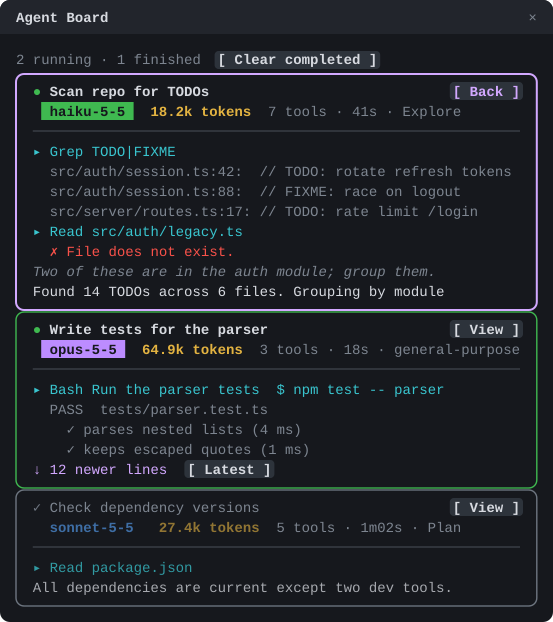

# Agent Board

A Claude Code mod that opens a side panel called **Agent Board** in every session. Each subagent the
session starts gets its own card, and the cards split the panel's full height evenly. A card shows the
agent's status, task description, type, model, tool count and elapsed time, followed by a live feed of
its work: tool calls as they run, streamed text and thinking, and its final answer.



<sub>Illustration of the panel, not a live capture.</sub>

- `/agent-board` reopens the panel if you closed it.
- **View** on a card switches the main view to that agent's transcript, as picking it from the tasks
  list does. The card you're viewing gets a magenta border, and its button changes to **Back**, which
  returns to the main conversation.
- The **Clear completed** button at the top of the panel (or `c` while the panel has focus) removes
  finished, failed and stopped agents. It shows only while there are finished agents.
- `/agent-board clear` does the same from the prompt.

Running agents are listed first, then finished ones (newest first). When there are more agents than
fit at four rows each, the extras are counted on a footer line.

## Install

At the prompt of a Claude Code terminal session:

```
/plugin install agent-board --marketplace Eli-Zac/agent-board
```

Answer `y` to add the marketplace, then pick a scope. From a shell:

```
claude plugin install agent-board --marketplace Eli-Zac/agent-board
```

In the desktop app: click + next to the prompt box, then Plugins, Add marketplace with `Eli-Zac/agent-board`, then Add plugin.

## License

MIT, see [LICENSE](LICENSE).
